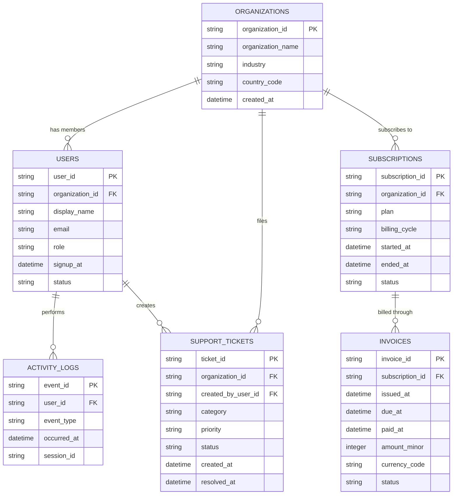

# DevData-01

**DevData-01** is a reproducible, synthetic relational dataset modeling a modern B2B SaaS application. It provides developers, data analysts, and learners with realistic, interconnected data across six core business domains: organizations, users, subscriptions, invoices, product activity logs, and customer support tickets.

"DevData-01 helps developers spend less time creating dummy data and more time building, testing, and learning with realistic, interconnected synthetic SaaS datasets."

[](LICENSE)
[](https://github.com/VedrajSingh21/devdata-01-synthetic-saas-dataset)
[](docs/DATA_QUALITY_REPORT.md)
[](data/)

---

## Why I Created This Dataset

When building prototypes, testing API endpoints, designing dashboards, or learning SQL, developers often rely on isolated mock rows or generic e-commerce toy datasets. These sources rarely capture the realities of multi-tenant B2B SaaS applications, such as:

- Organizations with multiple users and strict ownership roles.
- Subscription lifecycles with periodic recurring billing intervals.
- Delinquent billing states where past-due accounts connect to uncollected invoices.
- Product activity logs with permission boundaries (e.g., standard members cannot generate API keys).
- Customer support workflows that resolve based on priority SLAs.

I created DevData-01 to bridge this gap by offering a cohesive dataset that models these relationships out of the box, without requiring developers to invent and maintain six interconnected tables themselves.

---

## The Problem It Solves

- **Eliminates Manual Mock Data Construction:** Saves developers hours of writing throwaway data generators or manual SQL seed scripts.
- **Enforces Referential & Chronological Integrity:** Guarantees zero orphaned records, zero overlapping subscription periods for the same organization, and zero date sequence errors (e.g., invoices issued before subscription starts or events occurring before user signup).
- **Safe, Private Practice Environment:** Contains 100% synthetic records using RFC-reserved domains (`@example.com`), ensuring no risk of leaking real personal or financial data.

---

## Who Should Use This Dataset?

- **Full-stack Developers:** Seed local development environments and test API filtering, sorting, and pagination.
- **Backend Developers:** Design and test multi-tenant relational schemas, indexes, and database queries.
- **SQL and DBMS Learners:** Practice multi-table `JOIN` operations, window functions, common table expressions (CTEs), and aggregations on connected business entities.
- **Data Analysts & BI Practitioners:** Build SaaS operational dashboards tracking metrics like Monthly Recurring Revenue (MRR), collection rates, user engagement, and SLA resolution times.
- **SaaS Application Developers:** Prototype subscription management workflows, customer account views, and activity audit trails.
- **Students & Educators:** Provide a clean, shared relational schema for classroom demonstrations, academic coursework, and capstone projects.

---

## Key Features

- **Strict Referential Integrity:** Foreign keys resolve completely across all six tables with zero orphan rows.
- **Tenant Isolation:** 100% of support tickets are linked to users who belong to the ticket's organization.
- **Realistic Subscription Lifecycle:** Models active, canceled, past-due, trialing, and expired states with non-overlapping sequential tiers per organization.
- **Periodic Invoicing Cadence:** Generates monthly and annual invoices aligned with plan pricing schedules. Invoices are stored in integer minor units (USD cents) to prevent floating-point rounding errors.
- **Role-Based Event Restrictions:** Product event logs enforce role permissions; privileged administrative events (e.g., `api_key_generated`, `team_invite_sent`) are generated exclusively by `owner` and `admin` accounts.
- **SLA-Aware Support Resolution:** Support ticket resolution durations reflect priority SLAs (urgent tickets resolve significantly faster than low-priority tickets).
- **Deterministic & Zero-Dependency Generation:** Generated using Python standard library modules with a fixed random seed (`seed=42`).

---

## Dataset Overview

The dataset consists of **6 relational CSV files** containing a total of **19,800 records**:

| File | Entity Grain | Row Count | Primary Key | Foreign Keys |
| :--- | :--- | :---: | :--- | :--- |
| [`data/organizations.csv`](data/organizations.csv) | Customer company / tenant | 200 | `organization_id` | — |
| [`data/users.csv`](data/users.csv) | User profiles & team memberships | 2,000 | `user_id` | `organization_id` |
| [`data/subscriptions.csv`](data/subscriptions.csv) | Plan tiers & contract lifecycles | 300 | `subscription_id` | `organization_id` |
| [`data/invoices.csv`](data/invoices.csv) | Billing records & settlement history | 1,500 | `invoice_id` | `subscription_id` |
| [`data/activity_logs.csv`](data/activity_logs.csv) | Product interactions & audit trails | 15,000 | `event_id` | `user_id` |
| [`data/support_tickets.csv`](data/support_tickets.csv) | Customer support requests | 800 | `ticket_id` | `organization_id`, `created_by_user_id` |
| **Total** | | **19,800** | | |

Detailed field definitions, data types, and allowed enum values are available in the [Data Dictionary](docs/data_dictionary.md).

---

## Database Relationships



---

## Supported Developer Use Cases

- **Tenant-Scoped Queries:** Practice querying resources scoped to an individual organization (e.g., retrieving all active users and invoices for an account).
- **SaaS Metric Computation:** Calculate MRR by plan tier, estimate churn rates across cohorts, and evaluate invoice collection rates.
- **Event Audit Logs:** Query user product interactions by date range, action type, or user role.
- **Customer Support SLA Reporting:** Measure average and median resolution times across support categories and priorities.
- **Relational Schema Migrations:** Test DDL scripts, constraints, and foreign key cascades on relational sample tables.

---

## Quick Start

### Python Installation & Requirements

The project uses Python 3.8+ and only requires `pandas` to run the validation suite:

```bash
# Clone the repository
git clone https://github.com/VedrajSingh21/devdata-01-synthetic-saas-dataset.git
cd devdata-01-synthetic-saas-dataset

# Install test dependencies
pip install -r requirements.txt
```

### How to Generate the Dataset

The dataset can be generated deterministically using the included generation script:

```bash
python scripts/generate.py
```

This will produce all six canonical CSV files in the `data/` directory using seed `42`.

### How to Validate the Dataset

Run the automated validation suite to test schema conformance, referential integrity, date sequences, and business rules:

```bash
python scripts/validate.py
```

### PostgreSQL Import Instructions

A ready-to-run SQL schema file with table DDL, foreign key constraints, indexes, and `\copy` commands is provided in [`scripts/import_postgres.sql`](scripts/import_postgres.sql).

To import all tables into a PostgreSQL database:

```bash
psql -d your_database_name -f scripts/import_postgres.sql
```

The script creates the schema and loads all six CSV files directly from the `data/` folder.

### Example Analysis Notebook

An exploratory Jupyter notebook demonstrating key SQL-style joins, MRR analysis, billing metrics, and SLA statistics is available in [`notebooks/example_analysis.ipynb`](notebooks/example_analysis.ipynb).

To run the notebook:

```bash
jupyter notebook notebooks/example_analysis.ipynb
```

---

## Data Quality & Reproducibility

DevData-01 undergoes automated quality verification prior to every release. Verified audit results from v1.1.0:

- **Record Counts:** Exactly 19,800 records across all six tables.
- **Primary Keys:** 100% unique and non-null.
- **Foreign Keys:** 0 orphaned records across all relationships.
- **Financial Consistency:** 100% of invoice amounts match the published plan pricing schedule ($29/mo Starter, $99/mo Pro, $299/mo Enterprise). 0 invoices billed to Free plans.
- **Temporal Consistency:** 0 date sequence inversions (user signups occur after org creation; activity events occur after user signup; ticket resolution occurs after ticket creation).
- **Reproducibility:** Re-running `python scripts/generate.py` with `seed=42` produces identical CSV outputs verified via SHA-256 hashes.

A full breakdown is published in the [Data Quality Report](docs/DATA_QUALITY_REPORT.md).

---

## Dataset Limitations

To maintain transparency and prevent misuse:

- **Synthetic Data:** All records, company names, events, and metrics are algorithmically generated. They **do not represent real-world SaaS company data or empirical industry benchmarks**.
- **Simplified Financial Model:** DevData-01 models recurring subscription charges. It does not model tax rates, credit card processing fees, partial refunds, proration adjustments, or usage-metered billing line items.
- **Single-Tenant Memberships:** Each user belongs to exactly one organization. Multi-organization memberships (e.g., guest collaborators across teams) are not modeled in v1.1.0.

---

## Repository Structure

```text
devdata-01-synthetic-saas-dataset/
├── data/                                # Six interconnected CSV files (19,800 records)
│   ├── organizations.csv
│   ├── users.csv
│   ├── subscriptions.csv
│   ├── invoices.csv
│   ├── activity_logs.csv
│   └── support_tickets.csv
├── scripts/
│   ├── generate.py                      # Deterministic Python generator (seed=42)
│   ├── validate.py                      # Comprehensive validation suite
│   └── import_postgres.sql              # PostgreSQL DDL and CSV import script
├── notebooks/
│   └── example_analysis.ipynb           # Sample exploratory analytics notebook
├── docs/
│   ├── data_dictionary.md               # Complete schema definitions and field details
│   └── DATA_QUALITY_REPORT.md           # Formal quality audit and metric distribution report
├── .gitignore                           # Git ignore rules
├── requirements.txt                     # Minimal test dependencies
├── LICENSE                              # Creative Commons Attribution 4.0 International
└── README.md                            # Project documentation
```

---

## Kaggle Availability

A Kaggle dataset release for DevData-01 is currently **Coming Soon**. Once published, a direct Kaggle link will be added here.

---

## Contributing

Contributions, feedback, and issue reports are welcome! If you find a data consistency bug, have a suggestion for additional business scenarios, or want to contribute import scripts for other databases (e.g., MySQL, SQLite, DuckDB), please feel free to open an issue or submit a pull request.

1. Fork the repository.
2. Create your feature branch (`git checkout -b feature/new-database-import`).
3. Ensure all validation tests pass (`python scripts/validate.py`).
4. Commit your changes (`git commit -m 'Add DuckDB import script'`).
5. Push to the branch (`git push origin feature/new-database-import`).
6. Open a Pull Request.

---

## License

This dataset and its accompanying scripts are distributed under the **Creative Commons Attribution 4.0 International License (CC BY 4.0)**. See the [LICENSE](LICENSE) file for complete details.

---

## Author

Created and maintained by **Vedraj Singh** ([@VedrajSingh21](https://github.com/VedrajSingh21)).
